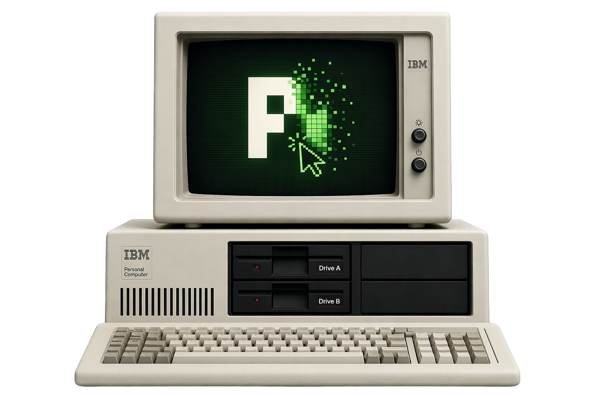

# pi-computer-use

<p align="center">
  
</p>

`pi-computer-use` lets AI agents use desktop apps on macOS, Windows, and Linux.

The macOS helper requires macOS 14 or newer; the [macOS reference](./docs/content/docs/reference/platforms/macos/implementation.mdx) maps each platform claim to Apple documentation and the implementation.

An agent can look at an app window, understand the buttons and text inside it, and perform actions like clicking, typing, scrolling, and waiting for something to change. This is useful when the agent needs to work with a normal desktop app instead of an API, a terminal command, or a file.

New to computer use? Start with: [Wait, what exactly is Computer Use?](https://zanechee.dev/what-exactly-is-computer-use/)

## What this package does

This is a Pi extension. After installation, Pi agents get tools for:

- finding open apps and windows
- observing what is visible in a window
- searching the visible interface for text, buttons, and controls
- inspecting parts of the interface in more detail
- clicking, typing, scrolling, and pressing UI controls
- waiting for UI changes
- observing a CDP browser page as an indexed action space and executing one observed action at a time (`jev_observe`, `jev_step`)
- optionally letting a TypeSafe policy choose the next operation and target, or run a bounded autonomous loop for a goal (`jev_run`)

In short: it gives an agent a controlled way to operate desktop software.

## What this package is not

`pi-computer-use` is not a replacement for app APIs or MCP servers. If an app has a reliable direct integration, use that first.

Computer use is most helpful when the only available interface is the app on screen.

## Install

```bash
pi install npm:@injaneity/pi-computer-use
```

Start Pi and complete the platform setup flow.

On macOS, the runtime installs the helper per user at `~/Applications/pi-computer-use.app` and requests Accessibility and Screen Recording. Existing writable system-wide installs remain at `/Applications/pi-computer-use.app`. Enable both grants for that app in System Settings, then choose Recheck. The [macOS reference](./docs/content/docs/reference/platforms/macos/accessibility.mdx#trust-and-permission) documents the exact APIs and avoids relying on version-specific pane labels.

On Windows, use an interactive desktop session. Windows support uses the platform accessibility APIs and does not use the macOS helper app.

On Linux, run Pi inside the target user's graphical session with a working AT-SPI2 accessibility bus. AT-SPI semantic operations remain background-first. X11 additionally supports EWMH window metadata/focus, window capture, and policy-gated XTEST physical input; strict headless/background policies never use focus or XTEST. Native Wayland remains semantic-only; diagnostics reads portal capability properties without creating a session, and interactive portal use is disabled. See [Linux support](./docs/content/docs/how-to-guides/linux.mdx) for the exact capability matrix and portal status.

Use `/computer-use` inside Pi to show the active configuration and where it came from.

## Main tools

- `find_roots`
- `observe_ui`
- `search_ui`
- `expand_ui`
- `inspect_ui`
- `act_ui`
- `read_text`
- `wait_for`
- `jev_observe`
- `jev_step`
- `jev_run`

Follow the [getting-started tutorial](./docs/content/docs/tutorials/getting-started.mdx), then use the generated [agent state and action contract](./docs/content/docs/reference/agent/contract.mdx) for operating behavior or the generated [tool schema reference](./docs/content/docs/reference/agent/tools.mdx) for exact parameters.

## Jev browser layer

For CDP browser pages, an optional layer ported from
[jev-ultrafast](https://github.com/browser-use/jev-ultrafast) adds a dynamic,
indexed action space: one code-owned id per actionable element, per-element
operations, and an executor that only runs observed actions with semantic
freshness and click-occlusion guards. `jev_step` can either execute an action
the agent picked or let a decision model choose, and `jev_run` drives a bounded
autonomous loop for one goal. Decision-making supports the Vercel AI SDK's
experimental evaluation API (`model: "typesafe-ai/jev"`) through AI Gateway and
the direct TypeSafe transport. It is **disabled by default** because
decision-making needs an additional credential, and it is controlled by
`jev_enabled`, `jev_decide`, `jev_backend`, `jev_model`, `jev_gateway_zdr`, and
`jev_max_steps`, or by `/computer-use jev on|off` and
`/computer-use jev-decide on|off`.

See [Jev browser layer](./docs/content/docs/explanation/jev.mdx) for the action-space format, credentials, and
guard semantics.

## Documentation

The docs follow [Diátaxis](https://diataxis.fr/) and render through the Next.js/Fumadocs app in [`docs/`](./docs/README.md). Run `npm install --prefix docs` once, then `npm run docs:dev` and open `http://localhost:8080/docs`.

- [Tutorials](./docs/content/docs/tutorials/getting-started.mdx)
- [How-to guides](./docs/content/docs/how-to-guides/troubleshooting.mdx)
- [Explanation](./docs/content/docs/explanation/architecture.mdx)
- [Reference](./docs/content/docs/reference/index.mdx)
- [Jev browser layer](./docs/content/docs/explanation/jev.mdx)
- [macOS root targeting](./docs/content/docs/reference/platforms/macos/root-targeting.mdx)
- [Linux support](./docs/content/docs/how-to-guides/linux.mdx)
- [Contributing](./CONTRIBUTING.md)

## Development status

The architecture is centered on immutable, state-scoped observations. Desktop surfaces and CDP pages form one multi-root forest; progressive outline queries remain cached, while live work is ordered per physical resource so independent roots can run in parallel. `act_ui` accepts one or more intent steps, preserves focus across dependent input, verifies delivery, recovers safely, stores one complete successor state, and returns a compact diff when identity confidence allows. Older direct tools such as `screenshot`, `click`, `set_text`, and `computer_actions` are no longer part of the public extension surface.

## License

MIT
